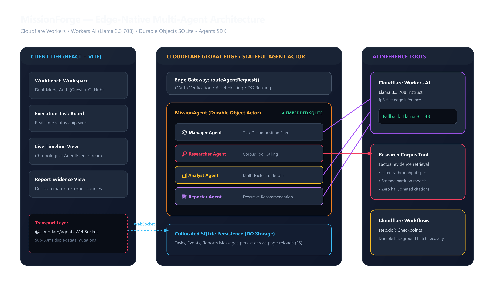

# MissionForge — AI Engineering Mission Workbench

> Turn an ambiguous engineering question into an evidence-backed architectural decision.

MissionForge is an autonomous multi-agent engineering workbench built natively on Cloudflare. It decomposes complex technical missions, collects evidence via technical research tools, contrasts systems trade-offs, and produces structured executive decision reports.



---

## Key Features

- **Multi-Agent Coordination**: Autonomous handoffs between **Manager** (Planner), **Researcher** (Evidence Collector), **Analyst** (Trade-Off Evaluator), and **Reporter** (Synthesis).
- **Native State Persistence**: Missions, tasks, and reports persist permanently via **Durable Objects with SQLite**.
- **Real-Time Execution Streaming**: Live WebSocket synchronization powered by the **Cloudflare Agents SDK**.
- **Workers AI**: Powered by `@cf/meta/llama-3.3-70b-instruct-fp8-fast` with automatic fallback to `@cf/meta/llama-3.1-8b-instruct`.
- **Engineering Workbench UI**: Clean 3-panel workspace with Recent Missions history, real-time Task Board, chronological Timeline, and Markdown-rendered Executive Reports.

---

## Cloudflare Services Used

| Primitive | Usage in MissionForge |
| :--- | :--- |
| **Cloudflare Agents SDK** | WebSocket session management and real-time state synchronization |
| **Durable Objects (SQLite)** | Single-tenant actor storage for persistent missions, tasks, and events |
| **Workers AI** | Serverless Llama 3.3 70B inference for multi-agent reasoning |
| **Cloudflare Workflows** | Durable multi-step checkpoint orchestration (`step.do()`) |
| **Static Assets** | High-performance edge delivery of the compiled React/Tailwind frontend |

---

## Local Setup

### 1. Prerequisites
- Node.js `20.19+` or `22.12+`
- Cloudflare account with a registered `workers.dev` subdomain

### 2. Installation
```bash
# Clone the repository
git clone [https://github.com/your-username/missionforge.git](https://github.com/your-username/missionforge.git)
cd missionforge

# Install backend dependencies
npm install

# Install client dependencies
cd client
npm install
cd ..

# Terminal 1: Start Cloudflare Worker Backend
npx wrangler dev

# Terminal 2: Start Vite Client
cd client
npm run dev